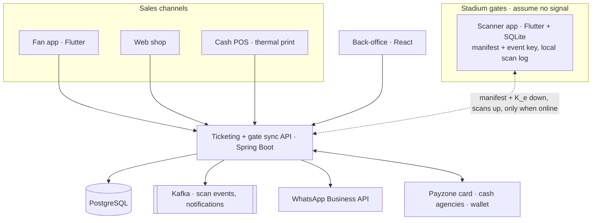

# Architecture

The server is the only source of truth; the scanner is the one component built to work
with the server unreachable.

## Components

| Component | Responsibility | Holds |
| --- | --- | --- |
| Ticketing API | Tenancy, catalog (venues, zones, gates, events, pricing), sales (orders, tickets, passes), payments, manifests, scan ingestion and duplicate resolution, finance, notifications | Master key, per-event keys (encrypted at rest), all records |
| Fan app | Discover, buy, hold tickets, rotating QR offline, transfer, split pay, membership, matchday companion, push | Per-ticket keys K_t for the user's own tickets |
| Web shop | Same purchase flow, PDF with static QR | Nothing after issue |
| Scanner app | Enrolment, manifest download, offline validation, local log, background sync, supervisor override | K_e in Keystore, manifest + scans in SQLite |
| Back-office | Event setup, zone/gate mapping, devices, live dashboard, reconciliation, finance, CRM, campaigns | Nothing (API client) |
| Kafka | Target: `scan.ingested` → dashboard projection; `order.paid` → ticket issue + WhatsApp delivery. Lot 2: the dashboard reads the scans table directly (polled every 5 s). Lot 4: fan messages and campaigns use the `fan_messages` DB outbox; the fan entry state is polled through `/fan/gates/{id}/load`. Kafka arrives only if the Lot 6 load test shows an async boundary. | — |

Lot 1: `order.paid` → WhatsApp delivery goes through a DB outbox (`ticket_deliveries`) polled by
`notifications`.

## Backend modules (modular monolith)

`tenancy` · `catalog` · `sales` · `payments` · `tickets` · `gate` · `finance` ·
`notifications` · `crm`. Modules talk through application services or domain events,
never through each other's repositories. One exception: a read-only report query may join another
module's tables (tenant-filtered, no writes) when one SQL statement is what keeps it fast, e.g. the gate
reports joining `tickets` for zone and status.

## Key flows

1. Purchase: reserve (8 min hold) → pay (card/wallet: hosted page + callback; cash: AWAITING_CASH + pay code, collected at a club till or by a network callback) → `order.paid` →
   tickets issued (K_t derived) → delivered (app, PDF, WhatsApp).
2. Gate: device enrol → event assignment → manifest + K_e download at T0 − 3 h → offline
   validate → background sync → server resolves first-scan-wins → dashboard.
3. Close: event closed → devices wipe → reconciliation report (sold / scanned / rejected /
   overrides per zone and gate; computed on read, final once every device acked) → settlement.

Details: `02-gate-validation-and-data-model.md`.
